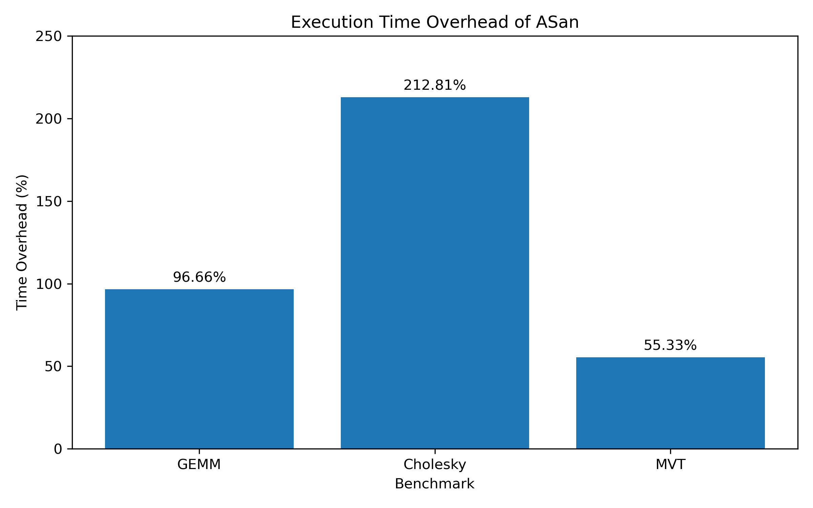
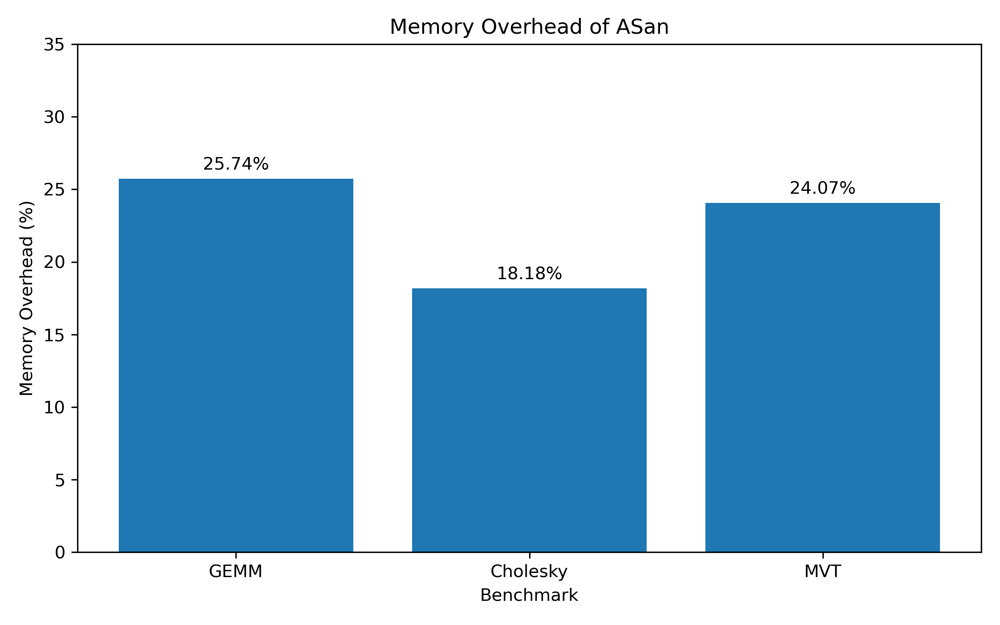

# Experimental Results

## 1. ASan Error Detection

The AddressSanitizer (ASan) test successfully detected a heap-buffer-overflow error in the test program.

The program allocated 10 bytes of memory and attempted to write to the 101st byte. ASan reported the invalid memory access and terminated the program. This result confirms that ASan was successfully enabled and could detect this type of memory error in our environment.

## 2. Performance Evaluation

We evaluated three benchmarks from PolyBench/C: GEMM, Cholesky, and MVT. Each benchmark was compiled in two versions: Normal and ASan.

Each version was executed three times. We measured execution time and maximum resident set size (RSS), and calculated the average values.

### 2.1 Raw Experimental Results

| Benchmark | Version | Avg. Time (s) | Avg. RSS (KB) |
|---|---|---:|---:|
| GEMM | Normal | 0.2966 | 29670.66 |
| GEMM | ASan | 0.5833 | 37308.00 |
| Cholesky | Normal | 17.3766 | 63898.66 |
| Cholesky | ASan | 54.3566 | 75513.33 |
| MVT | Normal | 0.0300 | 32730.66 |
| MVT | ASan | 0.0466 | 40609.33 |

### 2.2 Performance Overhead

The overhead was calculated by comparing the ASan version with the Normal version:

- Time overhead = (ASan time − Normal time) / Normal time × 100%
- Memory overhead = (ASan RSS − Normal RSS) / Normal RSS × 100%

| Benchmark | Time Overhead | Memory Overhead |
|---|---:|---:|
| GEMM | 96.66% | 25.74% |
| Cholesky | 212.81% | 18.18% |
| MVT | 55.33% | 24.07% |

### 2.3 Main Observations

The results show that ASan increased both execution time and memory usage across all three benchmarks.

Cholesky showed the largest time overhead, at 212.81%. GEMM had a time overhead of 96.66%, while MVT showed the smallest increase at 55.33%.

For memory usage, GEMM had the largest overhead at 25.74%, followed by MVT at 24.07% and Cholesky at 18.18%.

These results indicate that the performance overhead of ASan varied across different benchmarks.

One limitation is that MVT had a very short execution time (approximately 0.03–0.05 seconds). Therefore, its time overhead may be less precise due to the limited timing resolution.

## 3. Summary

The experiments confirmed that ASan successfully detected the tested heap-buffer-overflow error. The performance evaluation also showed that enabling ASan introduced additional execution time and memory overhead in all three benchmarks. The amount of overhead differed depending on the benchmark.